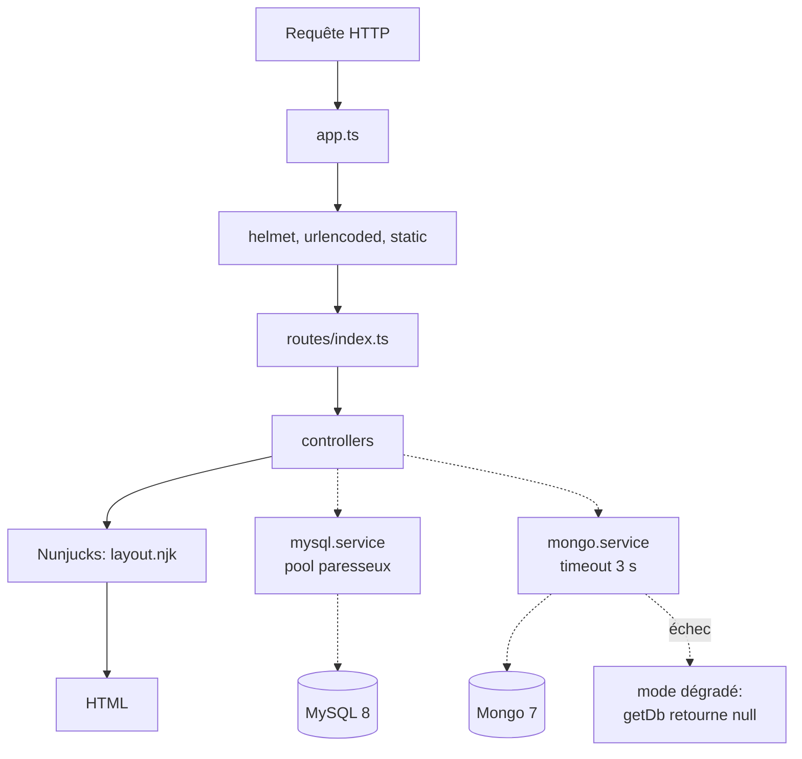

# EcoRide V2 — squelette

Plateforme de covoiturage. Réécriture Node 22 + TypeScript de la V1 (PHP/Slim).

Le schéma relationnel est en place (voir [Base de données](#base-de-données)) ;
les routes métier et les vues au-delà du layout restent à construire.

## Stack

| Couche | Techno |
|---|---|
| Runtime | Node 22, TypeScript strict (ESM) |
| Serveur | Express 5 |
| Vues | Nunjucks |
| Front | TypeScript compilé par esbuild |
| SQL | MySQL 8 (`mysql2`, pool) |
| Documents | MongoDB 7 (connexion paresseuse, dégradation gracieuse) |
| Tests | Vitest + supertest |

## Prérequis

- Node 22 ou plus
- Docker et Docker Compose

## Installation locale pas à pas

### 1. Récupérer le projet

```bash
git clone <url-du-depot>
cd ecoride-v2
```

### 2. Créer le fichier d'environnement

```bash
cp .env.example .env
```

Ouvrir `.env` et remplacer les valeurs `changeme` par des mots de passe de votre
choix. Ce sont **vous** qui les définissez : MySQL crée ses comptes avec ces
valeurs au premier démarrage.

| Variable | Rôle |
|---|---|
| `MYSQL_PASSWORD` | mot de passe de l'utilisateur applicatif `ecoride` |
| `MYSQL_ROOT_PASSWORD` | mot de passe administrateur du serveur MySQL |

`.env` n'est jamais commité (voir [Secrets](#secrets)).

### 3. Lancer les conteneurs

```bash
docker compose up --build
```

Trois services démarrent : `app` (Node), `mysql` (8.4) et `mongo` (7).
Ce terminal reste occupé par les logs — **ne pas le fermer**. Ouvrir un
**second terminal** pour la suite (VS Code : `Ctrl + Shift + ù`).

Vérifier que tout est en place :

```bash
docker compose ps
```

Les trois services doivent être `Up`, `mysql` et `mongo` marqués `healthy`.

### 4. Charger le schéma et les données

Les tables ne se créent pas toutes seules. Depuis le second terminal :

**PowerShell (Windows)**

```powershell
$pw = (Get-Content .env | Select-String '^MYSQL_PASSWORD=').ToString().Split('=',2)[1]
Get-Content db/schema.sql | docker compose exec -T mysql mysql -u ecoride "-p$pw" ecoride
Get-Content db/seed.sql   | docker compose exec -T mysql mysql -u ecoride "-p$pw" ecoride
```

**Bash (Linux, macOS, Git Bash)**

```bash
set -a && . ./.env && set +a
docker compose exec -T mysql mysql -u"$MYSQL_USER" -p"$MYSQL_PASSWORD" "$MYSQL_DATABASE" < db/schema.sql
docker compose exec -T mysql mysql -u"$MYSQL_USER" -p"$MYSQL_PASSWORD" "$MYSQL_DATABASE" < db/seed.sql
```

Aucune sortie signifie que tout s'est bien passé : en ligne de commande, seules
les erreurs s'affichent. Le message `[Warning] Using a password on the command
line interface can be insecure` est normal et sans conséquence en local.

> **Deux pièges fréquents.** L'opérateur `<` n'existe pas en PowerShell — d'où
> `Get-Content … |`. Et l'option `-p` doit être **collée** à sa valeur
> (`-pmonpass`) : avec un espace, MySQL prend le mot de passe pour le nom de la
> base.

### 5. Vérifier l'installation

```bash
curl http://localhost:3000/health
```

Réponse attendue :

```json
{"status":"ok","services":{"mysql":true,"mongo":true},"degraded":false}
```

Contrôler le contenu de la base :

```powershell
docker compose exec -T mysql mysql -u ecoride "-p$pw" ecoride -e "SHOW TABLES; SELECT COUNT(*) FROM users;"
```

Attendu : 7 tables et 10 utilisateurs.

L'application est accessible sur **http://localhost:3000**

| Route | Réponse |
|---|---|
| `GET /` | page HTML « EcoRide V2 OK » |
| `GET /health` | JSON, état de MySQL et Mongo (voir [principe 2](#trois-principes-à-connaître-avant-dajouter-du-code)) |

### 6. Arrêter

```bash
docker compose down          # arrête, garde les données
docker compose down -v       # supprime aussi les volumes (base remise à zéro)
```

Après un `down -v`, reprendre à l'étape 4 : les données ont disparu avec le
volume.

### Installation sans Docker

Les deux bases doivent tourner séparément sur la machine. Dans `.env`, remplacer
les hôtes `mysql` et `mongo` par `localhost`, puis :

```bash
npm install
npm run build:front
npm run dev
```

### Explorer la base avec MySQL Workbench

| Champ | Valeur |
|---|---|
| Hostname | `127.0.0.1` |
| Port | `3306` |
| Username | `ecoride` |
| Password | valeur de `MYSQL_PASSWORD` |
| Default Schema | `ecoride` |

Utiliser `127.0.0.1` plutôt que `localhost` : sous Windows, `localhost` peut se
résoudre en IPv6 et manquer la redirection Docker. **Database → Reverse
Engineer** génère le diagramme entité-association à partir du schéma réel.

## Commandes

| Commande | Effet |
|---|---|
| `npm run dev` | serveur en rechargement automatique (tsx) |
| `npm run build` | compile serveur + front |
| `npm run build:front` | compile `src/front/*.ts` vers `public/js/` |
| `npm run typecheck` | vérifie les types sans produire de fichiers |
| `npm start` | lance la version compilée (`dist/`) |
| `npm test` | lance les tests Vitest |

## Structure

```
src/
├── config/env.ts        # lecture des variables d'environnement
├── controllers/         # un fichier par groupe de routes
├── middleware/          # erreurs, et plus tard auth / CSRF
├── models/              # (vide) accès aux données
├── routes/index.ts      # table des routes
├── services/            # mysql.service.ts, mongo.service.ts
├── views/               # templates Nunjucks
├── front/               # TypeScript navigateur → public/js/
├── app.ts               # construction de l'app Express
└── server.ts            # écoute du port, arrêt propre
```

## Architecture



## Base de données

| Fichier | Rôle |
|---|---|
| [`db/schema.sql`](db/schema.sql) | DDL MySQL 8.4, rejouable (`DROP IF EXISTS` en tête). **Source de vérité.** |
| [`db/seed.sql`](db/seed.sql) | jeu de données de démonstration, `INSERT` uniquement |
| [`db/mcd.mmd`](db/mcd.mmd) | **MCD** — diagramme entité-association (Mermaid `erDiagram`) |

Le MCD reflète exactement `schema.sql` : 7 tables, clés primaires, clés
étrangères et types. `schema.sql` fait foi — toute évolution du DDL doit être
reportée dans `db/mcd.mmd`.

```bash
# Création du schéma puis chargement des données de démonstration
docker compose exec -T mysql mysql -uroot -p"$MYSQL_ROOT_PASSWORD" ecoride < db/schema.sql
docker compose exec -T mysql mysql -uroot -p"$MYSQL_ROOT_PASSWORD" ecoride < db/seed.sql
```

Deux règles sont portées par le SGBD et non par le code applicatif :

- **un trajet n'utilise que le véhicule de son chauffeur** — clé étrangère
  composite `trajets (vehicule_id, chauffeur_id) → vehicules (id, user_id)` ;
  toute tentative contraire est rejetée en `ERROR 1452` ;
- **un compte n'est jamais supprimé** — `users.deleted_at` horodate
  l'anonymisation, afin de préserver l'historique et la comptabilité.

## Trois principes à connaître avant d'ajouter du code

**1. Aucune base ne bloque le démarrage.**
Le pool MySQL et le client Mongo se créent au premier usage réel, pas au boot.
Une base éteinte n'empêche pas le serveur de répondre.

**2. Les deux bases n'ont pas le même poids. C'est une décision d'architecture.**

| Base | Contient | Si elle tombe | `/health` |
|---|---|---|---|
| MySQL | comptes, trajets, réservations, crédits | plus rien à servir | **503** |
| MongoDB | préférences de voyage | le reste fonctionne | **200** + drapeau |

Sans MySQL il n'y a ni comptes ni trajets : l'application est morte, elle doit
le dire. Sans Mongo il manque seulement les préférences : on sert la page et on
signale la dégradation. Un load balancer lit ce code pour décider s'il envoie du
trafic — un 200 sans MySQL enverrait des utilisateurs dans le vide.

**3. `getDb()` retourne `Db | null`.**
Le type force à écrire le cas d'échec. Sur les données secondaires, un `null`
doit dégrader l'affichage, jamais renvoyer une erreur 500 :

```ts
const db = await getDb();
if (db === null) {
  // Mongo indisponible : on affiche le trajet sans les préférences
  // du chauffeur, plutôt que rien du tout.
  return { ...trajet, preferences: null };
}
```

Côté MySQL, l'inverse : une erreur remonte et devient un 500. Ne jamais
l'avaler silencieusement — une réservation perdue sans bruit est pire
qu'une erreur visible.

## Déploiement

### Workflow Git

Le dépôt suit un modèle à trois niveaux. Aucun commit ne va directement sur
`main`.

```
feature/*  →  dev  →  main
```

| Branche | Rôle |
|---|---|
| `main` | état livrable, stable. Reçoit uniquement des fusions depuis `dev`. |
| `dev` | intégration continue des features terminées. |
| `feature/*` | une branche par fonctionnalité, créée depuis `dev`. |

```bash
# Démarrer une fonctionnalité
git switch dev
git switch -c feature/nom-de-la-feature

# … développer, committer …

# Intégrer dans dev (merge explicite, l'historique garde la trace de la branche)
git switch dev
git merge --no-ff feature/nom-de-la-feature

# Livrer : dev → main, une fois les tests verts
git switch main
git merge --no-ff dev
```

L'option `--no-ff` force un commit de fusion même quand l'avance est linéaire.
L'historique montre alors quelles features ont été livrées, et quand.

Règle appliquée sur ce dépôt : **pas de `push --force`, pas de réécriture des
commits publiés.** Corriger une erreur se fait par un nouveau commit, jamais en
modifiant l'historique que d'autres ont pu récupérer.

### Intégration continue

[`.github/workflows/ci.yml`](.github/workflows/ci.yml) s'exécute à chaque push
sur `main` et à chaque pull request :

| Étape | Commande |
|---|---|
| Installation | `npm ci` |
| Types serveur | `npm run typecheck` |
| Types front | `npx tsc -p tsconfig.front.json` |
| Compilation | `npm run build` |
| Tests | `npm test` |

Les tests n'ont besoin d'aucune base : les services se connectent
paresseusement, et les tests de `/health` utilisent des doublures.

### Mise en production

L'image est construite par [`Dockerfile`](Dockerfile) en trois étapes
(compilation, dépendances de production, image finale). L'image finale ne
contient ni sources TypeScript, ni dépendances de développement, et s'exécute
sous l'utilisateur non-root `node`.

```bash
docker build -t ecoride-v2:latest .
```

Variables à fournir à l'exécution — **jamais dans l'image** :

| Variable | Exemple |
|---|---|
| `NODE_ENV` | `production` |
| `PORT` | `3000` |
| `MYSQL_HOST`, `MYSQL_PORT` | hôte et port du serveur MySQL |
| `MYSQL_USER`, `MYSQL_PASSWORD`, `MYSQL_DATABASE` | identifiants applicatifs |
| `MONGO_URI`, `MONGO_DATABASE` | connexion MongoDB |

Le schéma (`db/schema.sql`) doit être appliqué sur la base cible avant le
premier démarrage. `db/seed.sql` contient des comptes de démonstration avec des
mots de passe connus : **ne jamais le charger en production.**

`GET /health` sert de sonde pour un orchestrateur : il renvoie `503` tant que
MySQL est injoignable, ce qui empêche l'envoi de trafic vers une instance
incapable de répondre.

## Secrets

`.env` est ignoré par git (`**/.env` dans `.gitignore`, sous-dossiers compris).
Seul `.env.example` est commité, avec des valeurs factices. Aucun mot de passe
ne doit apparaître dans un fichier suivi.

Les modèles MySQL Workbench (`*.mwb`) sont également ignorés : ce sont des
binaires regénérables depuis `db/schema.sql`, qui reste la source de vérité.
