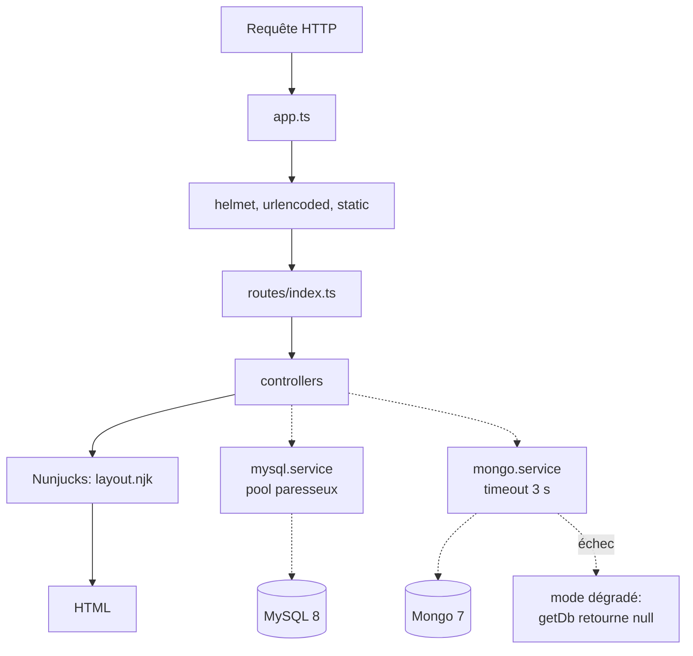

# EcoRide V2 — squelette

Plateforme de covoiturage. Réécriture Node 22 + TypeScript de la V1 (PHP/Slim).

Ce dépôt est un **squelette** : aucune table SQL, aucune route métier, aucune vue
au-delà du layout. Il sert de base saine pour construire les fonctionnalités.

## Stack

| Couche | Techno |
|---|---|
| Runtime | Node 22, TypeScript strict (ESM) |
| Serveur | Express 5 |
| Vues | Nunjucks |
| Front | TypeScript compilé par esbuild |
| SQL | MySQL 8 (`mysql2`, pool) |
| Documents | MongoDB 7 (connexion paresseuse, dégradation gracieuse) |
| Tests | Vitest + supertest |

## Prérequis

- Node 22 ou plus
- Docker et Docker Compose

## Démarrage avec Docker (recommandé)

```bash
cp .env.example .env    # puis remplir les mots de passe
docker compose up --build
```

L'application écoute sur http://localhost:3000

| Route | Réponse |
|---|---|
| `GET /` | page HTML « EcoRide V2 OK » |
| `GET /health` | JSON avec l'état de MySQL et Mongo |

Arrêt :

```bash
docker compose down          # garde les données
docker compose down -v       # supprime aussi les volumes
```

## Démarrage sans Docker

Les bases doivent tourner séparément. Dans `.env`, remplacer les hôtes
`mysql` et `mongo` par `localhost`.

```bash
npm install
npm run build:front
npm run dev
```

## Commandes

| Commande | Effet |
|---|---|
| `npm run dev` | serveur en rechargement automatique (tsx) |
| `npm run build` | compile serveur + front |
| `npm run build:front` | compile `src/front/*.ts` vers `public/js/` |
| `npm run typecheck` | vérifie les types sans produire de fichiers |
| `npm start` | lance la version compilée (`dist/`) |
| `npm test` | lance les tests Vitest |

## Structure

```
src/
├── config/env.ts        # lecture des variables d'environnement
├── controllers/         # un fichier par groupe de routes
├── middleware/          # erreurs, et plus tard auth / CSRF
├── models/              # (vide) accès aux données
├── routes/index.ts      # table des routes
├── services/            # mysql.service.ts, mongo.service.ts
├── views/               # templates Nunjucks
├── front/               # TypeScript navigateur → public/js/
├── app.ts               # construction de l'app Express
└── server.ts            # écoute du port, arrêt propre
```

## Architecture



## Deux principes à connaître avant d'ajouter du code

**1. Aucune base ne bloque le démarrage.**
Le pool MySQL et le client Mongo se créent au premier usage réel, pas au boot.
Une base éteinte n'empêche pas le serveur de répondre.

**2. `getDb()` retourne `Db | null`.**
Le type force à écrire le cas d'échec. Sur les données secondaires (préférences,
avis), un `null` doit dégrader l'affichage, pas renvoyer une erreur 500.

```ts
const db = await getDb();
if (db === null) {
  // TODO(human): décider quoi afficher quand Mongo est indisponible
  return;
}
```

## Secrets

`.env` est ignoré par git (`**/.env` dans `.gitignore`). Seul `.env.example`
est commité, avec des valeurs factices. Aucun mot de passe ne doit apparaître
dans un fichier suivi.
